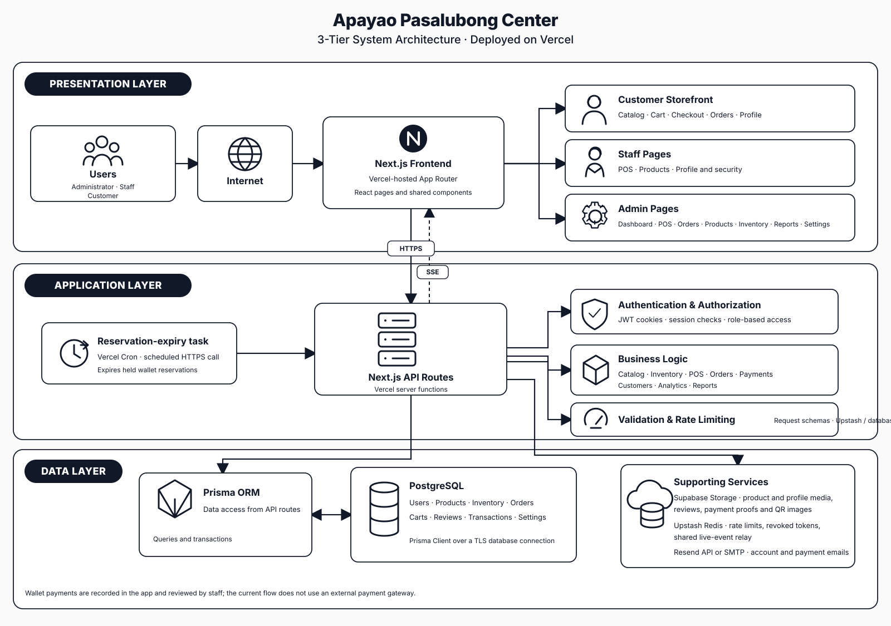
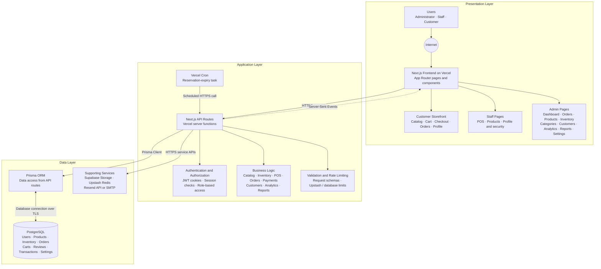

# System architecture

This diagram describes the deployed Apayao Pasalubong Center app as a three-tier system: the browser-facing storefront and admin pages, the Vercel-hosted Next.js application, and the database and supporting services.

## Editable diagram

The deployed Next.js app serves customer, staff, and administrator experiences and handles API requests in Vercel server functions. Prisma accesses PostgreSQL; the application also calls Supabase Storage for product, profile, review, and payment media, Upstash Redis for shared rate limits, revoked token IDs, and live-event relay, and Resend or SMTP for account and payment emails.

Vercel Cron calls the reservation-expiry endpoint on its configured schedule. Wallet payments are recorded as orders and reviewed by staff; 
